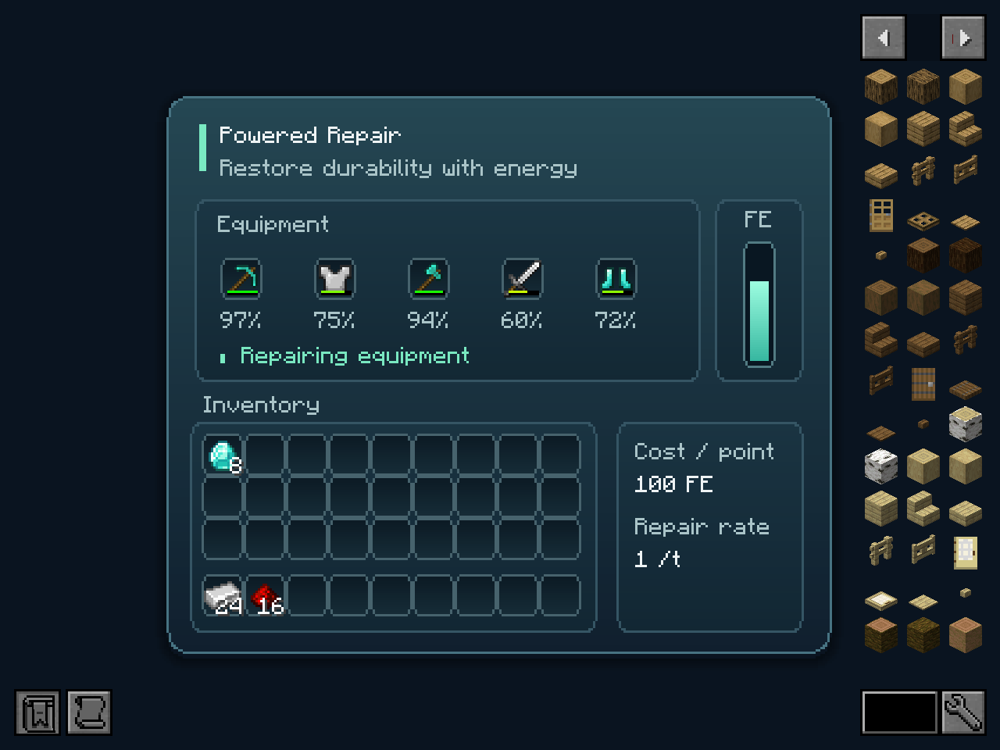
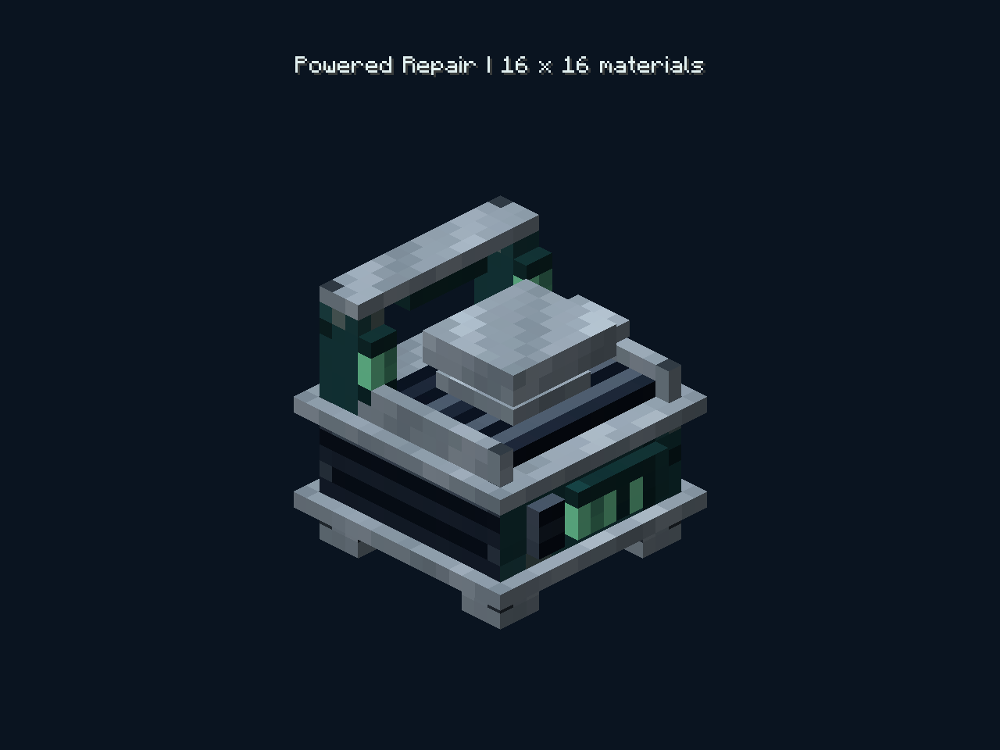

# Repair station presentation

The workstation combines a recessed tool bed, a small anvil, a raised rear repair frame, steel edging, vented side panels and mint circuit plates. Placement faces the machine toward the player. The same model and four 16×16 material PNGs are generated for all six targets; vanilla item rendering also supplies its inventory and creative-tab icon.

The source artwork is `assets-source/repair-materials.png`, created with the built-in image generator. `tools/prepare_textures.py` splits its four quadrants and resizes each to **16×16 with nearest-neighbor sampling**, as requested. Only those small material PNGs enter the mod JARs; the full atlas stays in the repository. The model source is `tools/station_assets.py`.

All geometry and UV boundaries sit on integer coordinates. Every face has explicit UVs with exactly **one texel per model unit** on both axes. Small circuit plates select a matching-size crop of the material instead of shrinking the whole tile onto the plate. Generation and packaged-JAR checks validate all 132 faces against the actual texture dimensions and reject stretched mappings, partial-pixel geometry and rescaling rotations.

## Screen and interaction





The compact 284×238 layout fits Minecraft's normal minimum GUI viewport. A navy/teal OpenUI surface contains five equipment wells, per-item remaining durability, an energy gauge, an inventory grid and a separate hotbar. Repair status distinguishes empty, repairing, complete, insufficient power and redstone-paused states. Cost and maximum repair rate are always visible.

The energy tooltip shows stored/capacity energy, repair speed and input faces. It refreshes while the pointer remains still. Equipment help explains valid items, shared repair rate, durability percentages and completed-only automation extraction.

Minecraft owns actual slots, item tooltips, carried stacks, click/drag/hotbar shortcuts and shift-click. Shift-click inserts eligible equipment, removes equipment at any repair stage and moves other items between the player's main inventory and hotbar. Native server checks exercise both transfer directions and invalid-item rejection. Energy/settings use split data slots to preserve 32-bit values across the vanilla signed-short wire format.

Economy's real-container/OpenUI separation and Biotech's tinted surfaces and live-tooltip lifecycle were used as references. `templates/LiveTooltipComponent.java` adapts the user's Biotech helper; OpenUI itself remains a separate client dependency, pinned to published version 0.0.16 for development. Loader metadata requires 0.0.16 or newer without an upper version limit.

## Verification commands

```text
python -m unittest discover -s tools -p test_workspace.py
python tools/build.py all
python tools/smoke.py <target>
python tools/preview.py
```

The native server probes intentionally omit OpenUI at runtime (`-PclientUi=false`). `DEV_SMOKE=true` also loads the locked JEI and generator setup. The preview task uses a separate client and a copy of the module-owned smoke-test world; it does not open the user's world. Preview sources and screenshots are excluded from release JARs. Its eight PNGs and success manifest are written to `neoforge-1.21.1/build/ui-previews`.

The preview renders production screens with sample menu data and uses Minecraft's baked item model for the workstation view. It is not evidence of physical mouse interaction or of a live multiplayer network. Cross-version native probes establish server/menu behavior, while client appearance was inspected on NeoForge 1.21.1.

## Image generation prompt

Create a Minecraft block texture atlas, a single exactly square image divided into four exactly equal quadrants, no gaps, no borders, no text, no objects in perspective. These are four flat orthographic seamless material tiles for a premium industrial repair workbench. Top left: brushed pale cool steel, subtle low-contrast chunky pixel highlights and tiny darker rivets at corners. Top right: dark desaturated petrol-teal painted machine casing, subtle edge wear and small panel seams. Bottom left: near-black navy ventilation grille, regular horizontal slat pixel pattern with steel-gray recessed edges. Bottom right: restrained mint-green emissive circuit/power panel, dark teal base with a few bold luminous mint pixel paths and compact status rectangles, no letters. Important visual style: authentic vanilla Minecraft 16x16 pixel art PER QUADRANT, each tile should visibly have a 16-by-16 grid of large clean perfectly square flat-color pixels; no fine detail, no dithering, no blur, no smooth lighting, no gradients, no antialiasing, no transparency. Each quadrant fills its exact quarter of the canvas edge-to-edge. Four cohesive textures, limited palette, elegant functional machinery. These will be separately cropped and reduced to actual 16x16 PNG textures.
